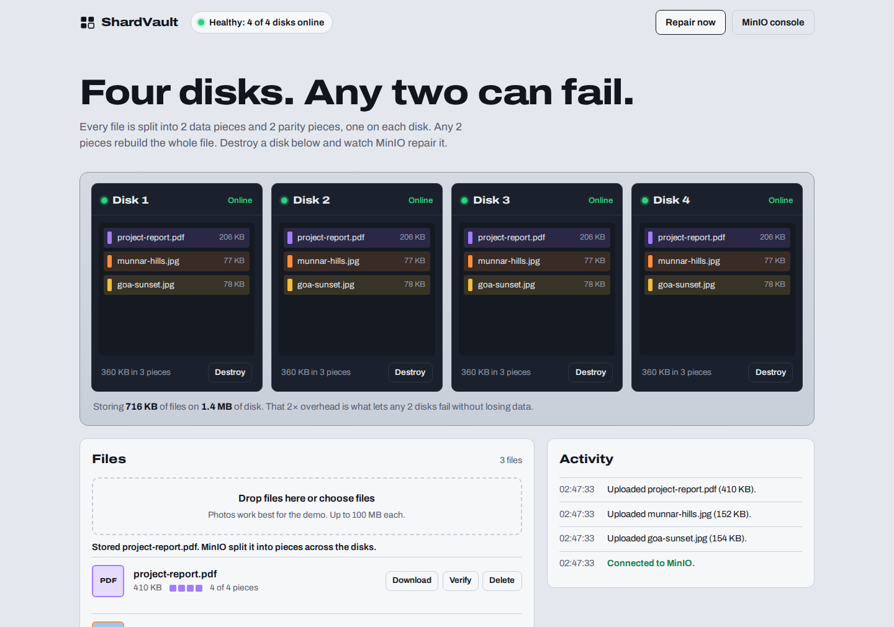
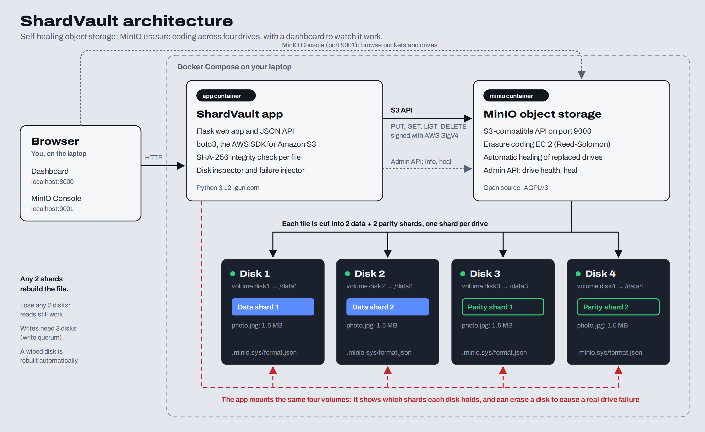
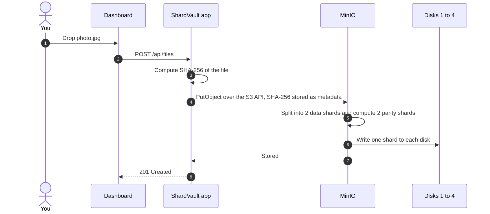
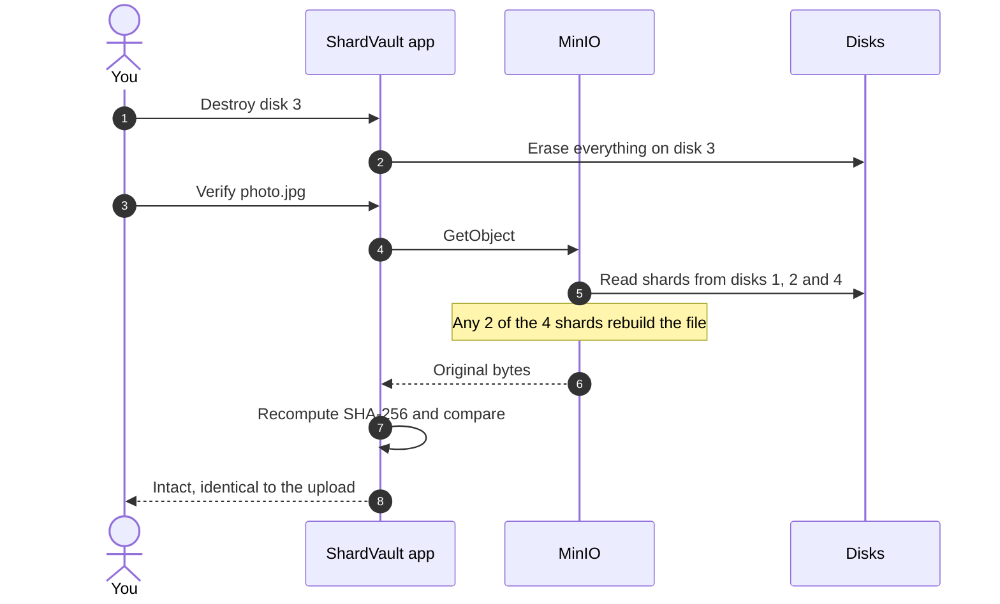
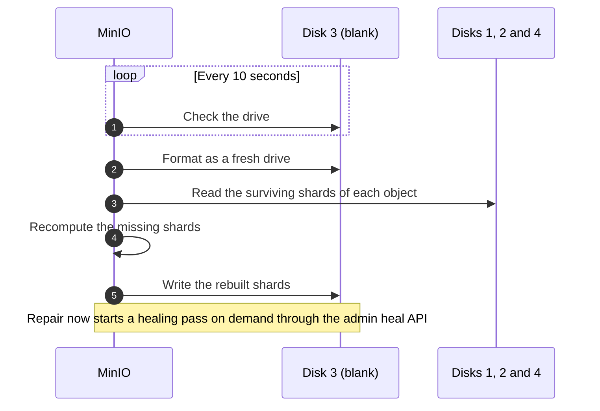
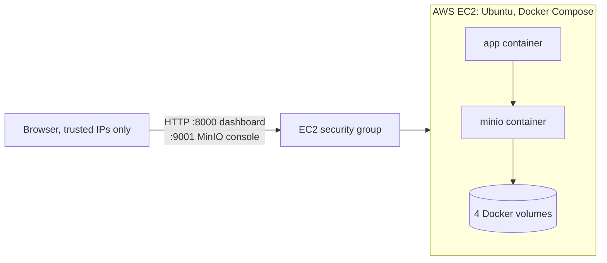

# ShardVault

**Self-healing object storage you can break on purpose.**

[](https://github.com/SmritiSinha-03/ShardVault/actions/workflows/ci.yml)


ShardVault runs a private, Amazon S3-compatible storage service on four disks using [MinIO](https://min.io), and adds a live dashboard that shows exactly where every piece of every file is stored. Destroy a disk with one click, prove that every file still downloads bit-for-bit, then watch the storage rebuild the lost disk on its own.



---

## Contents

- [Why this exists](#why-this-exists)
- [Features](#features)
- [Architecture](#architecture)
- [How it works](#how-it-works)
- [Workflows](#workflows)
- [Getting started](#getting-started)
- [Deployment on AWS](#deployment-on-aws)
- [Walkthrough: break it and watch it heal](#walkthrough-break-it-and-watch-it-heal)
- [Command-line tool](#command-line-tool)
- [API reference](#api-reference)
- [Configuration](#configuration)
- [Testing](#testing)
- [Project structure](#project-structure)
- [Troubleshooting](#troubleshooting)
- [Production notes and limitations](#production-notes-and-limitations)
- [License](#license)

## Why this exists

Disks fail. The simple defence is to keep three full copies of everything, which survives two failures but triples the storage bill. Large storage systems such as Amazon S3, Azure Blob Storage and Google Cloud Storage use **erasure coding** instead: each object is cut into data pieces, extra parity pieces are calculated from them, and the pieces are spread across drives. Any sufficient subset of pieces can rebuild the original.

ShardVault makes that idea visible and testable on a laptop or a cloud server. With four disks and two parity pieces per file, it survives **any two disk failures while using only 2× the space**, compared with 3× for triple copies.

## Features

- **S3-compatible storage.** Files are stored through the standard Amazon S3 API using `boto3`, the official AWS SDK, so the same code works with MinIO, Amazon S3 or any S3-compatible service.
- **Erasure coding across four disks.** Every file becomes 2 data shards and 2 parity shards, one per disk (MinIO storage class `EC:2`, Reed-Solomon).
- **Live shard map.** Each disk bay lists the pieces it holds and their sizes, read directly from the drive.
- **Failure injection.** "Destroy disk" permanently erases a disk's contents, including MinIO's drive identity, exactly like replacing a dead drive with a blank one.
- **Integrity verification.** A SHA-256 fingerprint is recorded at upload. "Verify" reads the file back, possibly from a damaged cluster, and proves it is identical.
- **Self-healing.** MinIO detects the blank drive and rebuilds every missing shard automatically, usually within 20 seconds. A single missing piece is restored within about a second of the next read.
- **Quorum awareness.** The dashboard shows when the cluster is fully working, read-only or unavailable, and uploads are refused safely when too few disks remain.
- **Activity log** narrating every failure, rebuild and verification as it happens.
- **One command to run** with Docker Compose, on a laptop or on a cloud server such as AWS EC2.

## Architecture



| Component | Technology | Responsibility |
|---|---|---|
| Dashboard | HTML, CSS, vanilla JavaScript | Upload, download, verify and delete files; show each disk's pieces; destroy disks; trigger repair. Polls the status endpoint every 1.2 s. |
| ShardVault app | Python 3.12, Flask, boto3, gunicorn | JSON API. Talks to MinIO over the S3 API (signed with AWS Signature Version 4) and the MinIO admin API. Inspects the four disk volumes to build the shard map. |
| MinIO | MinIO server RELEASE.2025-01-20, `EC:2` | Stores objects with erasure coding across four drives, enforces read and write quorum, and heals replaced drives in the background. |
| Disks | Four Docker named volumes | `disk1` to `disk4`, mounted into MinIO as `/data1` to `/data4` and into the app as `/storage/disk1` to `/storage/disk4`. |

The official `minio/minio` image is no longer publicly available on Docker Hub, so [`minio/Dockerfile`](minio/Dockerfile) builds a small image from MinIO's open-source package on [conda-forge](https://anaconda.org/conda-forge/minio-server). It works on both x86-64 and ARM64 machines.

The disks are Docker volumes rather than folders in the project directory because MinIO's multi-drive mode requires direct I/O, which folders shared from Windows or macOS into Docker do not always support. Volumes live inside Docker's own Linux file system and behave the same on every operating system.

## How it works

### Erasure coding

When you upload a 3 MB photo, MinIO splits it into two 1.5 MB **data shards** and computes two 1.5 MB **parity shards** with a Reed-Solomon code. Each of the four disks receives one shard. Any two shards, whichever two, are enough to reconstruct the full photo.

| Disks online | Reads | Writes | Dashboard shows |
|:---:|:---:|:---:|---|
| 4 of 4 | Yes | Yes | Healthy |
| 3 of 4 | Yes | Yes | Degraded, fully working |
| 2 of 4 | Yes | No | Degraded, read-only |
| 1 of 4 | No | No | Data unavailable |

Reads need 2 disks (the number of data shards). Writes need 3: when data and parity shard counts are equal, MinIO requires one extra disk for writes so that two isolated halves of a cluster can never both accept conflicting changes.

### Self-healing

MinIO checks its drives every 10 seconds. A drive without MinIO's format file is treated as a freshly replaced disk: MinIO formats it, reads the surviving shards of every object from the other disks, recomputes the missing shards and writes them back. Healing also happens on access: if a read finds a shard missing, MinIO queues that object for repair. **Repair now** calls MinIO's admin heal API (the same operation as `mc admin heal --recursive`) to start a healing pass on demand. In the MinIO release used here, a completely wiped disk must first be re-formatted by the background check, so whole-disk recovery takes about 10 to 20 seconds either way, while an individual missing piece is restored within about a second of the next read.

### What the dashboard measures

- **Disk state** combines MinIO's own view of each drive (from the admin API) with what is physically on the volume: whether MinIO's format file exists, and which object shards are present.
- **File integrity** compares the SHA-256 stored in the object's metadata at upload with a fresh SHA-256 of the bytes MinIO returns.
- **Storage overhead** compares the total size of your files with the space their shards actually occupy across the disks.

## Workflows

### Upload



### Disk failure and read



### Self-healing



## Getting started

### Prerequisites

- **Docker Desktop** (Windows, macOS) or **Docker Engine with the Compose plugin** (Linux). On Windows, Docker Desktop needs WSL 2, which its installer sets up.
- About 1 GB of free disk space for the images.
- Optional: **Python 3.10+**, only to run the tests and the command-line checks on your own machine.

### Run

```bash
git clone https://github.com/SmritiSinha-03/ShardVault.git
cd ShardVault
docker compose up --build
```

The first start downloads the base images and the MinIO server and builds both containers, which takes a few minutes. Later starts take seconds. When the logs settle, open:

| What | Address | Login |
|---|---|---|
| ShardVault dashboard | http://localhost:8000 | none |
| MinIO Console | http://localhost:9001 | `shardvault` / `shardvault-secret` |
| S3 API endpoint | http://localhost:9000 | same as the console |

### Stop and reset

```bash
docker compose down        # stop; files and disks are kept
docker compose down -v     # stop and delete all four disks and every file
```

To use different ports or credentials, copy `.env.example` to `.env` and edit it.

## Deployment on AWS

ShardVault runs anywhere Docker runs. It has been deployed on an **AWS EC2** instance in the Mumbai region (`ap-south-1`) using the same Docker Compose setup as local development.



**Steps in brief:**

1. **Launch an EC2 instance:** Ubuntu Server (x86-64), `t3.small` (or `t3.micro` with 2 GB of swap), 20 GiB gp3 storage. A free-tier-eligible instance keeps it within AWS free credits.
2. **Configure the security group:** allow port `8000` (dashboard) and, optionally, `9001` (MinIO Console) only from trusted IP addresses (`x.x.x.x/32`). Allow SSH from your own IP or from the EC2 Instance Connect prefix list. Never expose port `9000` publicly.
3. **Install Docker** on the instance:
   ```bash
   curl -fsSL https://get.docker.com | sudo sh
   sudo usermod -aG docker ubuntu   # then log out and back in
   ```
4. **Clone, set a password and start:**
   ```bash
   git clone https://github.com/SmritiSinha-03/ShardVault.git
   cd ShardVault
   echo "MINIO_ROOT_PASSWORD=$(openssl rand -hex 16)" > .env
   docker compose up -d --build
   ```
5. **Open** `http://<public-ip>:8000` for the dashboard and `http://<public-ip>:9001` for the MinIO Console (user `shardvault`, password from `cat .env`).

**Operating notes:**

- Update the deployment after pushing changes: `git pull && docker compose up -d --build`.
- The containers restart automatically when the instance reboots.
- The public IP changes if the instance is stopped and started again.
- The dashboard's **MinIO console** button points to `localhost`; on a server, open `http://<public-ip>:9001` directly.
- The dashboard has no login, so access is restricted with security group rules. Terminate the instance when it is no longer needed to avoid using credits.

## Walkthrough: break it and watch it heal

1. **Upload a few photos.** Drag them onto the Files panel. Each disk bay now lists one piece of each photo, each half the photo's size.
2. **Destroy a disk.** Click **Destroy** on Disk 3 and confirm. Its LED turns red and the bay is empty: the data is really gone from that volume.
3. **Prove nothing was lost.** Click **Verify** on a photo. It is read back from the three remaining disks and its SHA-256 matches the original. Its thumbnail still loads, and **Download** still works.
4. **Watch it heal.** Usually within 20 seconds MinIO detects the blank drive, the LED turns amber while it rebuilds, then green. Every piece reappears and the activity log reports how long it took.
5. **Push it further.** Destroy two disks at once. Files still download, but new uploads are refused with a clear message because writing safely needs three disks. Click **Repair now** to bring everything back.
6. **Find the limit.** Destroy three disks: the data becomes unavailable, which is exactly the boundary that two parity shards provide.

## Command-line tool

The same operations are available from a terminal, which is useful to show the failure happening "outside" the dashboard:

```bash
docker compose exec app python cli.py status      # disk health, pieces and quorum
docker compose exec app python cli.py destroy 3   # erase disk 3
docker compose exec app python cli.py repair      # rebuild missing pieces now
```

To look at the raw shard files MinIO writes, open Docker Desktop, go to **Volumes**, and browse `shardvault_disk1` to `shardvault_disk4`, or run:

```bash
docker compose exec app find /storage/disk1/vault
```

## API reference

| Method | Path | Description |
|---|---|---|
| `GET` | `/api/status` | Disk states, shard map, file list, quorum and storage usage |
| `POST` | `/api/files` | Upload a file (multipart field `file`); returns its key, size and SHA-256 |
| `GET` | `/api/files/{key}` | Download a file; add `?inline=1` to display it in the browser |
| `POST` | `/api/files/{key}/verify` | Re-read the file and compare its SHA-256 with the stored one |
| `DELETE` | `/api/files/{key}` | Delete a file from every disk |
| `POST` | `/api/disks/{n}/destroy` | Erase everything on disk `n` (1 to 4) |
| `POST` | `/api/repair` | Start a MinIO healing pass on every disk |
| `GET` | `/healthz` | Liveness check |

Errors are JSON, for example `{"error": "unavailable", "message": "Not enough healthy disks to store new files safely. Downloads still work."}` with HTTP 503.

## Configuration

Set these in `.env` (copied from `.env.example`). All have working defaults.

| Variable | Default | Purpose |
|---|---|---|
| `MINIO_ROOT_USER` | `shardvault` | MinIO administrator name, also used by the app |
| `MINIO_ROOT_PASSWORD` | `shardvault-secret` | MinIO administrator password (8+ characters) |
| `APP_PORT` | `8000` | Dashboard port on your machine |
| `MINIO_API_PORT` | `9000` | S3 API port on your machine |
| `MINIO_CONSOLE_PORT` | `9001` | MinIO Console port on your machine |
| `BUCKET` | `vault` | Bucket that holds the files |

The app container also reads `S3_ENDPOINT`, `STORAGE_DIR`, `DISK_COUNT`, `MAX_UPLOAD_MB` (default 100) and `MINIO_CONSOLE_URL`; Docker Compose sets them for you.

### Using Amazon S3 instead of MinIO

Because the app speaks the standard S3 API, uploading, listing, downloading and verifying work against Amazon S3 by leaving `S3_ENDPOINT` empty and providing AWS credentials in the usual way (environment variables, `~/.aws` or an IAM role), plus `S3_REGION` and a globally unique `BUCKET`. The disk map, failure injection and repair are MinIO-specific and are reported as unavailable in that mode.

## Testing

```bash
python -m venv .venv
source .venv/bin/activate          # Windows: .venv\Scripts\activate
pip install -r requirements-dev.txt

pytest                             # 27 unit tests, no Docker needed
ruff check . && ruff format --check .
```

The unit tests cover file-name sanitising, quorum arithmetic, disk-state rules, shard inspection, erasing a disk, the full HTTP API (with S3 emulated in memory by [moto](https://github.com/getmoto/moto)), tamper detection, and signing of MinIO admin requests.

The **resilience test** runs the whole failure story against the real stack:

```bash
docker compose up -d --build
python scripts/integration_test.py
```

```
  ✓ app is up and all 4 disks are online
  ✓ uploaded a 2.5 MB file, one piece stored on each of the 4 disks
  ✓ destroyed disk 2: file still downloads with an identical SHA-256
  ✓ MinIO rebuilt disk 2 by itself in 18s
  ✓ destroyed disks 1 and 3: file still downloads intact
  ✓ uploads are refused while only 2 disks remain (write quorum protection)
  ✓ repair rebuilt both disks in 18s
  ✓ uploads work again

All resilience checks passed.
```

GitHub Actions ([`.github/workflows/ci.yml`](.github/workflows/ci.yml)) runs lint and unit tests on every push, then starts the full Docker Compose stack and runs the resilience test against real MinIO.

## Project structure

```
ShardVault/
├── minio/
│   └── Dockerfile           MinIO server image built from conda-forge
├── app/
│   ├── app.py               Flask app and JSON API
│   ├── vault.py             S3 client, MinIO admin API, disk inspection, quorum logic
│   ├── cli.py               Command-line tool (status, destroy, repair)
│   ├── templates/index.html Dashboard page
│   ├── static/              CSS, JavaScript, font, favicon
│   ├── requirements.txt
│   └── Dockerfile
├── tests/                   Unit tests (pytest + moto)
├── scripts/
│   └── integration_test.py  End-to-end resilience test
├── docs/
│   ├── architecture.png     Architecture diagram
│   ├── architecture.html    Diagram source
│   ├── render_diagram.py    Re-renders the diagram
│   └── screenshots/
├── .github/workflows/ci.yml
├── docker-compose.yml
├── .env.example
├── requirements-dev.txt
└── README.md
```

## Troubleshooting

| Symptom | Fix |
|---|---|
| `error during connect` or `Cannot connect to the Docker daemon` | Start Docker Desktop and wait until it says it is running. |
| `port is already allocated` | Another program uses 8000, 9000 or 9001. Set `APP_PORT`, `MINIO_API_PORT` or `MINIO_CONSOLE_PORT` in `.env`. |
| `pull access denied for minio/minio` | You are running an older copy of `docker-compose.yml`. The current one builds MinIO locally (`build: ./minio`). |
| Dashboard stays on "Connecting to MinIO" | MinIO is still starting. Check `docker compose logs minio`. |
| A disk stays on "Rebuilding" | Click **Repair now**. |
| Uploads are refused | Fewer than three disks are healthy. Click **Repair now** or wait for automatic healing. |
| Deployed page does not load | Make sure the URL starts with `http://` and that your current IP is allowed in the EC2 security group. |
| Start completely fresh | `docker compose down -v`, then `docker compose up --build`. |

## Production notes and limitations

ShardVault is a demonstration and learning tool. Before using these ideas for real data:

- **Separate physical drives and servers.** All four "disks" here share one physical disk and one machine, so they protect against drive-level failures only. `MINIO_CI_CD` relaxes MinIO's checks for this laptop setup and must not be used on real servers. Production MinIO spreads drives across several servers.
- **Credentials.** The app uses the MinIO root account for simplicity. A real deployment would give it a dedicated user with a minimal policy and enable TLS.
- **Access control.** The dashboard has no login; when deployed, restrict access with firewall or security group rules.
- **Failure injection is destructive by design.** The app mounts the disks with write access so it can erase them.
- **Single bucket, files up to 100 MB** through the dashboard.

## License

MIT, see [LICENSE](LICENSE). MinIO is a separate project licensed under the GNU AGPLv3 and is installed unmodified from its conda-forge package. The dashboard uses the Archivo typeface under the SIL Open Font License.
